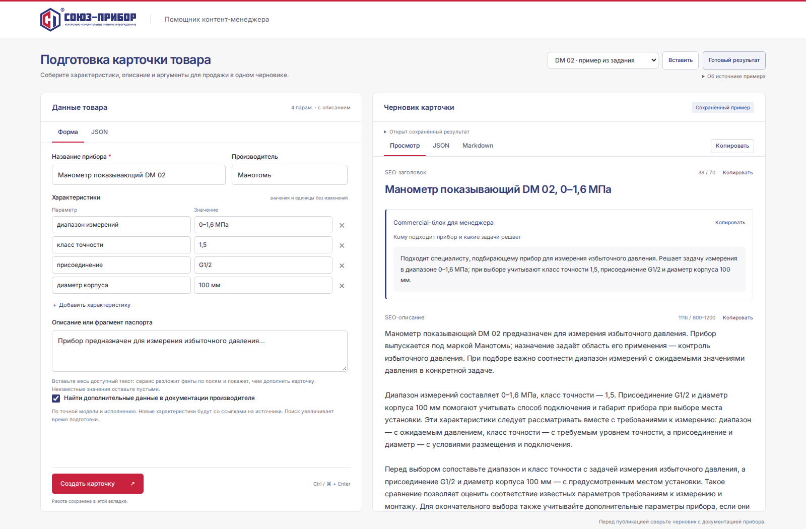
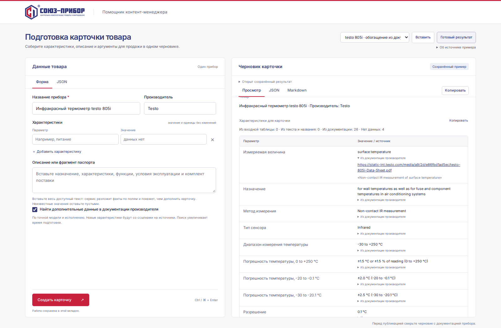
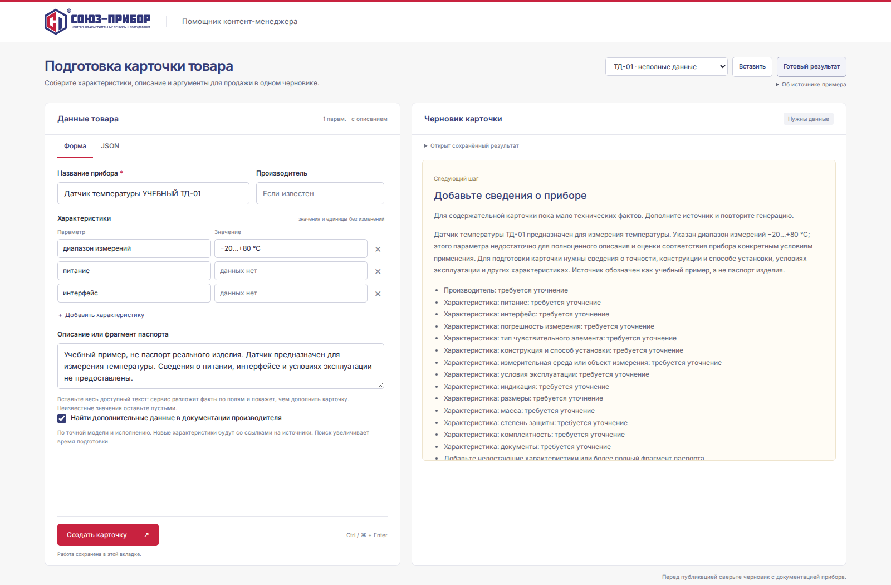

<p></p>

# Прибор

**AI-помощник контент-менеджера: из технических данных — в черновик B2B-карточки.**

[](https://github.com/goorov2000/souz-pribor-ai/actions/workflows/check.yml)

Python 3.11+ · FastAPI · Pydantic · OpenAI API · HTML/CSS/JavaScript

Помощник принимает название, характеристики и фрагмент паспорта, собирает текст и таблицу, показывает пропуски. Контент-менеджер проверяет черновик и забирает его в JSON или Markdown. Приложение запускается локально; сохранённые примеры доступны без API-ключа.

[Быстрый запуск](#быстрый-запуск) · [Примеры](#примеры-результатов) · [Проверки](#проверки) · [Устройство](docs/decisions.md) · [HTTP API](docs/api.md)



*Настоящий интерфейс приложения. На скриншотах открыты сохранённые ответы реального API; новые генерации для съёмки не выполнялись.*

## Что получает редактор

| Блок | Результат |
| --- | --- |
| SEO | Заголовок до 70 символов и описание 800–1200 символов; длины проверяет сервер |
| Характеристики | Исходные значения, извлечённые факты с цитатами и пометки «данных нет» |
| Поисковые запросы | 3–5 разных фраз для страницы товара |
| Commercial-блок | Кому подходит прибор и какую подтверждённую задачу решает |
| Экспорты | Просмотр, копирование отдельных блоков, скачивание JSON и Markdown |

Форма и JSON работают с одним набором данных. Изменение ввода помечает старый результат как устаревший. Ввод и предыдущая карточка восстанавливаются после перезагрузки текущей вкладки; для постоянного хранения результат нужно скачать.

<table>
<tr>
<td width="50%"><a href="docs/screenshots/sources.png"></a></td>
<td width="50%"><a href="docs/screenshots/needs-data.png"></a></td>
</tr>
<tr>
<td><strong>Проверяемое происхождение.</strong> В дополнительном режиме новые факты сопровождаются ссылкой на документ и цитатой.</td>
<td><strong>Понятный следующий шаг.</strong> При скудном источнике сервис просит дополнить данные вместо длинного текста из догадок.</td>
</tr>
</table>

## Быстрый запуск

Нужны Python 3.11+ и [uv](https://docs.astral.sh/uv/getting-started/installation/).

```bash
git clone https://github.com/goorov2000/souz-pribor-ai.git
cd souz-pribor-ai
uv sync --frozen --group dev
```

Запустите приложение:

```bash
uv run uvicorn app.main:app --host 127.0.0.1 --port 8000
```

Откройте **http://127.0.0.1:8000**. Выберите товар и нажмите **«Готовый результат»**: это просмотр сохранённого ответа, без вызова модели. Остановка сервера — Ctrl+C.

Для **новой генерации** скопируйте `.env.example` в `.env.local`, задайте `OPENAI_API_KEY` в редакторе и перезапустите сервер. Существующий файл с настройками не перезаписывайте.

<details>
<summary>Создание файла конфигурации в Linux/macOS/WSL и Windows</summary>

Linux/macOS/WSL:

```bash
test -e .env.local || cp .env.example .env.local
```

Windows PowerShell:

```powershell
if (-not (Test-Path .env.local)) { Copy-Item .env.example .env.local }
```

</details>

| Переменная | По умолчанию | Назначение |
| --- | --- | --- |
| `OPENAI_API_KEY` | Не задан | Серверный ключ; для просмотра примеров не нужен |
| `OPENAI_MODEL` | `gpt-6-luna` | Модель без автоматического переключения |
| `OPENAI_TIMEOUT_SECONDS` | `45` | Таймаут сетевых операций HTTPX, секунды |

Переменные окружения имеют приоритет перед `.env.local`. Ключ не передаётся в браузер, не включается в примеры и игнорируется Git. После изменения конфигурации нужен перезапуск. `/api/health` проверяет наличие настройки, а доступность модели определяется при запросе.

## Два режима работы

| Режим | Откуда берутся технические значения |
| --- | --- |
| **Только исходные данные**, `enrich: false` | Название, описание и характеристики пользователя. Режим соответствует исходному ТЗ |
| **Поиск документации**, `enrich: true` | Дополнительно — документы точной модели с проверкой скачанного текста, цитатами и URL. Это расширение исходного ТЗ |

В HTTP API поиск **выключен по умолчанию**, в веб-форме **включён**. Для проверки исходного задания снимите «Найти дополнительные данные в документации производителя» после загрузки примера. Поиск увеличивает время и API-расходы; отсутствие подтверждённого источника показывается явно.

При достаточном источнике возвращается `draft`. Если фактов мало, приложение выдаёт `needs_data` с известными сведениями и списком дополнений. Краткая справка не выдаётся за SEO-карточку. Пустой источник обрабатывается без вызова модели.

## Примеры результатов

| Пример | Вход | Результат | Происхождение |
| --- | --- | --- | --- |
| Манометр DM 02 | [JSON](examples/dm02.input.json) | [Карточка](examples/dm02.result.md) · [Метаданные](examples/dm02.result.json) | JSON-пример из PDF задания; четыре исходных параметра |
| Testo 805i | [JSON](examples/testo805i.input.json) | [Карточка](examples/testo805i.result.md) · [Метаданные](examples/testo805i.result.json) | Самостоятельно выбранный реальный прибор по данным производителя |
| ТД-01: неполные данные | [JSON](examples/training.input.json) | [Справка](examples/training.result.md) | Вымышленный учебный набор для проверки нехватки сведений |
| Testo 805i: поиск документации | [JSON](examples/testo805i-enriched.input.json) | [Карточка с источниками](examples/testo805i-enriched.result.md) | Дополнительный режим: 26 строк из документации при пустой входной таблице |

В полученном PDF найден один пример DM 02; второй товар работодателя отсутствует. Testo не обозначается как предоставленный работодателем, а учебный ТД-01 не заменяет вторую полную карточку.

Результаты получены через реальный API на более ранних снимках. В `metadata.provenance` сохранены дата, вход и хеши кода; usage и число попыток — рядом. Эти файлы демонстрируют конкретные ответы, а не гарантируют воспроизведение такого же текста текущей моделью. [Проверка результатов и границы приёмки](docs/acceptance.md).

## Проверки

```bash
uv run --frozen python scripts/check.py
```

Одна команда создаёт чистый снимок исходников, устанавливает зависимости из lock-файла и проверяет приложение. Реальные ключи не передаются; платных запросов нет.

| Уровень | Последний локальный прогон | Что проверяется |
| --- | --- | --- |
| API и обработка данных | **87 passed** | Ввод, структура, длины, факты, цитаты, ошибки, конфликты, обогащение и экспорты |
| Изолированный браузер | **13 passed** | Форма/JSON, копирование, сохранение работы, вкладки и неполные данные |
| Настоящий сервер + браузер | **9 passed** | Холодный запуск, первый клик, скачивание, генерация и восстановление после ошибок |

Внешние ответы OpenAI и документов в техническом прогоне подменены. Смысловая оценка **новых** ответов модели в него не входит. Журналы, исходный снимок, скриншоты и трассы сохраняются в `artifacts/check/`; GitHub Actions публикует их как артефакт запуска. Первый прогон скачивает Chromium; на Linux нужны его системные библиотеки.

[Как устроен check и CI](docs/check-workflow.md) · [Приёмка по ТЗ](docs/acceptance.md) · [Происхождение скриншотов](docs/screenshots/README.md)

## Как устроено приложение

```text
app/
  main.py         HTTP-маршруты и ограничения запросов
  models.py       Схемы входа и ответа модели
  provider.py     OpenAI Responses API и безопасные ошибки
  prompts.py      Промпт подготовки карточки
  cards.py        Проверка, сборка карточки и экспорты
  grounding.py    Ограниченные проверки исходных фактов
  enrichment.py   Поиск и проверка документации
static/           Интерфейс, логотип и локальные шрифты
examples/         Входы и сохранённые живые результаты
```

Инструкции и товарные данные передаются раздельно. Структуру задаёт JSON Schema, а длины, исходные значения и часть привязок к источнику проверяет сервер. При нарушении разрешена одна коррекция; после повторной ошибки готовая карточка не выдаётся.

## Ограничения

- Результат — черновик. Совпадение чисел и цитат не доказывает правильную смысловую связь; назначение, совместимость и условия применения сверяет редактор по паспорту.
- Поиск не гарантирует полноту или отсутствие ошибок источника. Нужны доступные HTML/PDF с извлекаемым текстом; OCR и обход блокировок не реализованы.
- Нет авторизации, CMS, БД, массовой обработки и промышленного SLA. Сервер предназначен для локального запуска. Деплой исходным заданием не требуется и не выполнялся.
- Следующий шаг — расширить оценку на реальных товарах и правках контент-менеджеров; для регулярной работы добавить историю и контроль расходов.

[Технические решения](docs/decisions.md) · [Контракт API](docs/api.md) · [Дизайн](DESIGN.md) · [Соответствие ТЗ](docs/acceptance.md)
